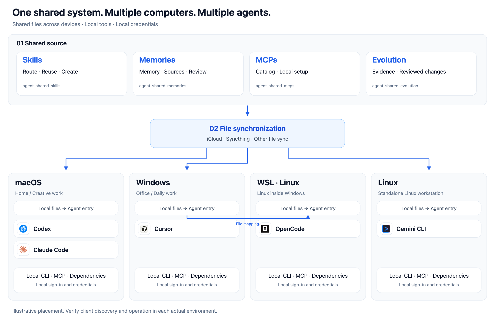

<h1 align="center">Agent Shared System</h1>

<p align="center"><strong>One shared system. Multiple computers. Multiple agents.<br>一套共享文件，多台电脑，多个 Agent。</strong></p>

<p align="center"><a href="https://github.com/severusgao/agent-shared-system/releases/latest"></a> <a href="LICENSE"></a> <a href="docs/getting-started.en.md"></a> <a href="https://github.com/severusgao/agent-shared-system/actions/workflows/check.yml"></a></p>

<p align="center"><a href="docs/compatibility.en.md"></a> <a href="docs/compatibility.en.md"></a> <a href="docs/compatibility.en.md"></a> <a href="docs/compatibility.en.md"></a></p>

<p align="center"><a href="#synchronization"></a> <a href="#synchronization"></a></p>

<p align="center"><a href="#installation">Install</a> · <a href="#agents">Agents</a> · <a href="#overview">Overview</a> · <a href="#architecture">Architecture</a> · <a href="#memory-comparison">Memory comparison</a> · <a href="#documentation">Docs</a></p>

<p align="center"><strong>English</strong> · <a href="README_CN.md">简体中文</a></p>

Keep skills, reviewed long-term memory and MCP setup instructions in one shared folder. Start with **iCloud Drive**, or choose **Syncthing** for open-source synchronization across macOS, Windows and Linux. Each computer reads local files; tools, sign-in and credentials stay local.

以 iCloud 为主要示例，让多台电脑上的 Agent 共用技能、记忆和 MCP 说明；也可选择开源的 Syncthing。文件跨端共享，工具与凭据各机准备。

<a id="installation"></a>

## Install

**Download → choose a sync folder → connect your local agent.**

1. Download the complete ZIP from [Releases](https://github.com/severusgao/agent-shared-system/releases/latest). Extract it into its final synchronization folder and keep the hidden `.agents` directory. Ensure the files are available locally.
2. Prepare Python **3.12+** and an agent in the current environment, then run its entry point:

   | Environment | Entry point |
   |---|---|
   | macOS | `Start.command` |
   | Windows | `Start-Windows.cmd` |
   | Linux | `bash Start-Linux.sh` |
   | WSL | Run `bash Start-Linux.sh` inside the selected distribution, using the mounted Windows project folder |

3. Check the actual agent skills directory, review the plan and apply it. Reload the agent, confirm it can read the core skills, then query the fictional **Atlas** sample.

The launcher offers to prepare missing core Python dependencies in a machine-local environment. It previews changes and preserves conflicting private skills. See the [complete setup guide](docs/getting-started.en.md), including a prompt you can give your agent.

On another computer, let the same shared source finish synchronizing, then run that environment's entry point. **Files available → agent discovers skills → dependencies ready → real task succeeds** are separate checks.

<a id="agents"></a>

## Agent setup

These are setup-directory templates, not a claim that every client version has passed a real session test. Verify the directory your current client actually loads; use `--target-dir` when it differs.

| Client | Setup option | Provided |
|---|---|---|
|  Codex | `--agent codex` | Directory template |
|  Claude Code | `--agent claude` | Directory template |
|  Gemini CLI | `--agent gemini` | Directory template |
|  Cursor | `--agent cursor` | Directory template |
|  OpenCode | `--agent opencode` | Directory template |
| Hermes | `--agent hermes` | Directory template |
| WorkBuddy | `--agent workbuddy` | Directory template |

Icons identify example clients. [Platform and client validation](docs/compatibility.en.md) explains what the automated checks cover; [asset attribution](assets/ATTRIBUTION.md) identifies the icon sources. Hermes here is a skills-directory entry, not a Hermes Gateway integration.

<a id="overview"></a>

## What this system shares

A file-based framework for **multiple computers and multiple agents**. The core uses readable Markdown, JSON and lightweight scripts, with no always-on memory server or database.

| Core skill | Responsibility |
|---|---|
| `agent-shared-skills` | Route tasks, reuse and create skills, maintain local discovery links |
| `agent-shared-memories` | Query relevant context, track sources, review candidates and maintain approved conclusions |
| `agent-shared-mcps` | Maintain MCP catalogs and templates; prepare and verify each host and agent |
| `agent-shared-evolution` | Collect retrospective evidence, review changes and verify their results |

Project-specific skills can call shared skills by name. A new skill explains its purpose, triggers, steps, dependencies and success criteria. CLI/MCP skills also explain how each host prepares its tools. See [authoring skills](docs/authoring-skills.en.md).

### Who it is for

- Individuals continuing work between an office Windows PC and a home Mac.
- People using several computers, Linux or WSL, and several agents.
- Users who want readable, reviewable and portable memory.
- Small teams that can coordinate file writes and choose a suitable synchronization provider.

Computers can read already-synchronized local files while another computer is off. New updates depend on the selected sync tool, and models or external tools may need network access. Team members use separate accounts where the provider supports them and coordinate edits to the same file. The framework provides no memory-level ACL, database transactions or distributed lock.

<a id="architecture"></a>

## Shared architecture



[Open the full-size diagram](assets/architecture.en.png) · [How the components work together](docs/overview.en.md)

Agent placement is illustrative. WSL may read Windows-mounted shared files while keeping its own Linux runtime. Standalone Linux is a separate environment and uses an available synchronization provider.

```text
AgentShared/
├── README.md / Start.*
├── .agents/
│   ├── skills/       Shared methods and governance
│   ├── memories/     Maintained context and blank personal templates
│   ├── mcp/          Catalog and setup templates
│   ├── evolution/    Reviewed proposals and retrospectives
│   ├── scripts/      Maintenance tools
│   └── state/        Initialized environment records
├── docs/
└── examples/         Method-only and CLI examples
```

Share durable instructions and reviewed knowledge. Keep binaries, secrets, caches, live databases and real agent configuration local. Public releases contain neutral templates and fictional examples.

<a id="synchronization"></a>

## File synchronization

**iCloud Drive is the primary walkthrough. Syncthing is an optional alternative.** Choose one provider for the shared folder.

| Option | Suitable use | Platforms and availability |
|---|---|---|
| [iCloud Drive](https://support.apple.com/guide/icloud/set-up-icloud-drive-mm203b05aec8/icloud) | An existing Apple/iCloud workflow | macOS and Windows; WSL can read the Windows folder. No official Linux client is assumed. |
| [Syncthing](https://github.com/syncthing/syncthing) | An open-source cross-platform option | macOS, Windows and Linux; devices exchange files while connected and online. |

Syncthing needs overlapping online time between devices carrying the new changes, or another device that retains and forwards them. An optional NAS or third computer can fill that role. Already-synchronized files remain locally readable. Follow the [official Syncthing guide](https://docs.syncthing.net/intro/getting-started.html) for setup.

Use a regular local folder for Syncthing, outside another provider's managed folder. Synchronize the project source including `.agents`, then create each computer's agent links locally. See [choosing a sync provider](docs/getting-started.en.md#choose-a-sync-provider).

<a id="memory-comparison"></a>

## Why file-based memory

We studied [TencentDB Agent Memory](https://github.com/TencentCloud/TencentDB-Agent-Memory), a strong service-based project with centralized processing and management capabilities.

Our strengths are local file access across devices, continuity between work and home, directly reviewable and portable text, optional independent review by multiple agents, and a shared source for skills, memory and MCP instructions. Tencent's system can run locally or in WSL; multiple devices sharing it need access to a common running backend. It does not inherently require purchasing a server.

Multi-agent review must actually be organized and performed. We have not benchmarked accuracy, recall or cost against Tencent's project. See the [detailed comparison and pinned source references](docs/comparison.en.md).

<a id="documentation"></a>

## Documentation

[Setup and second computer](docs/getting-started.en.md) · [Architecture](docs/overview.en.md) · [Authoring skills](docs/authoring-skills.en.md) · [Optional extensions](docs/extensions.en.md) · [Compatibility](docs/compatibility.en.md) · [Tencent comparison](docs/comparison.en.md)

[Contributing](CONTRIBUTING.md) · [Security](SECURITY.md) · [Changelog](CHANGELOG.md) · [Initial release audit (中文)](docs/release-audit.md) · [Report an issue](https://github.com/severusgao/agent-shared-system/issues)

Original core code is [MIT licensed](LICENSE). Third-party brand assets are excluded from that grant. Automated filesystem checks do not establish real agent discovery, WSL behavior or every external tool integration.
