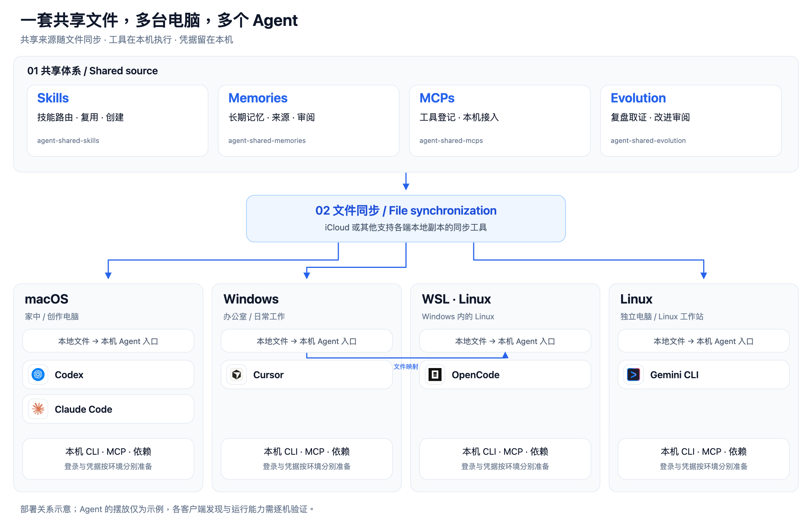

# Agent Shared System

[](https://github.com/severusgao/agent-shared-system/actions/workflows/check.yml)

**一套共享文件，多台电脑，多个 Agent。**

**同步方式：** [](https://support.apple.com/guide/icloud/set-up-icloud-drive-mm203b05aec8/icloud) [](https://github.com/syncthing/syncthing)

[English](README.md) · **简体中文** · [开始使用](docs/getting-started.md) · [架构说明](docs/overview.md) · [与腾讯方案对比](docs/comparison.md)

把技能、审阅过的长期记忆和 MCP 安装说明放进一个共享目录，用 iCloud、Syncthing 或其他文件同步工具送到各台电脑。Codex、Claude Code、Gemini CLI、Cursor、OpenCode 等 Agent 通过各自的本机入口读取它；工具、依赖、登录和凭据在每台机器分别准备。

核心采用 Markdown、JSON 和轻量脚本，无需常驻记忆服务器或数据库。它是可部署的文件协作框架，配有治理技能与接入工具。



图中 Agent 的分布仅为部署示意；不表示这些客户端已全部通过实机兼容性验证。图标归属见[来源说明](assets/ATTRIBUTION.md)。

## 适合谁

- 办公室用 Windows、回家用 Mac，希望接续已有工作背景的个人。
- 同时使用多台电脑、独立 Linux 或 WSL，希望多个 Agent 共用技能与记忆的人。
- 希望直接阅读、检查、迁移和备份自己的记忆，不额外维护跨地点记忆后台的人。
- 已有文件同步工具、愿意协调写入的个人或小团队。团队使用独立成员账号及目录权限。

多台电脑可以读取已同步的本地副本；办公室电脑关机后，家中电脑仍可读取已经落地的内容。新内容到达取决于同步工具，同一文件的并发写入仍需协调。模型服务和外部工具可能需要联网。

## 四个核心技能

| 技能 | 职责 |
|---|---|
| `agent-shared-skills` | 任务路由、共享技能复用与创建、本机技能入口维护 |
| `agent-shared-memories` | 按需查询长期记忆、记录来源、审核候选内容、维护现行结论 |
| `agent-shared-mcps` | MCP 注册表与模板、逐机安装、逐 Agent 配置和调用验证 |
| `agent-shared-evolution` | 复盘取证、改进提案、审阅记录与实施后的验证 |

项目专属技能可以按任务调用共享技能。新技能必须写清用途、触发条件、步骤、依赖与成功判据；涉及 CLI 或 MCP 时补充各系统安装说明。另一台电脑读到技能后，仍要完成本机依赖与实际调用验证。详见[技能编写指南](docs/authoring-skills.md)。

## 文件同步

同一共享目录选择一个同步工具。上方徽章表示可选方案，不代表已捆绑软件或完成集成实测。

| 方案 | 适合谁 | 平台与同步条件 |
|---|---|---|
| [iCloud Drive](https://support.apple.com/guide/icloud/set-up-icloud-drive-mm203b05aec8/icloud) | 已有苹果/iCloud 工作流的使用者 | macOS、Windows；WSL 可读取 Windows 同步目录。不假定 Linux 有官方客户端。 |
| [Syncthing](https://github.com/syncthing/syncthing) | 希望三个桌面系统使用同一开源同步工具的人 | macOS、Windows、Linux；设备在线且可连接时交换文件。 |

Syncthing 由设备互相同步。办公室电脑和家中电脑要有同时在线的时间，或通过另一台保有新内容的电脑、NAS 接续传递。第三台设备是可选的文件同步节点，不是必须部署的记忆服务器；已经同步的内容可继续本地读取。设置方式见[官方入门指南](https://docs.syncthing.net/intro/getting-started.html)，在线条件见[官方 FAQ](https://docs.syncthing.net/users/faq.html#what-is-syncthing)。

Syncthing 使用普通本地目录，避开其他同步工具托管的目录。同步完整项目（包括隐藏的 `.agents`），再在每台机器建立自己的 Agent 入口；不把 Agent 用户目录、真实 MCP 配置或 Syncthing 自身运行数据库放进来。WSL 可复用 Windows 同步后的文件，依赖与 Agent 仍在各发行版内准备。该选项已核对官方文档，尚未完成本框架的跨设备同步实测。

## 下载后怎么用

1. 从 [Releases](https://github.com/severusgao/agent-shared-system/releases) 下载发行版 ZIP，完整解压到你选择的同步目录；确认隐藏的 `.agents` 目录保留、文件已下载到本地。
2. 当前系统准备 Python 3.12+ 和至少一个 Agent。macOS 运行 `Start.command`，Windows 运行 `Start-Windows.cmd`，Linux/WSL 运行 `bash Start-Linux.sh`。
3. 根据提示核对 Agent 实际技能目录，审阅接入计划，再应用。重载 Agent，验证它能读取核心技能并查询虚构的 Atlas 示例记忆。

也可以把本机项目路径交给 Agent，让它按 [首次接入指南](docs/getting-started.md) 帮你完成。核心依赖只需 PyYAML；安装依赖会联网，运行环境放在本机。当前客户端不接受默认目录时，使用 `--target-dir` 指定其真实入口。

第二台电脑等待目录同步后，再运行自己的系统入口。**共享文件已同步、Agent 已发现、依赖已就绪、实际调用通过是四个不同阶段。** 独立 Linux 使用该平台可用的同步方案；WSL 可访问 Windows 同步目录，不假定 Linux 有官方 iCloud 客户端。

## 记忆系统的优势在哪里

我们研究过优秀的 [TencentDB Agent Memory](https://github.com/TencentCloud/TencentDB-Agent-Memory)。它提供服务化记忆处理与管理能力，适合评估集中后台、自动处理及团队权限需求。

本项目的优势在于**跨端文件协作**：各端读取本地副本，跨地点接续无需另设到办公室记忆后台的访问通道；记忆可直接阅读、审阅和迁移；多个 Agent 可以参与整理与独立复核；技能、记忆和 MCP 说明使用同一共享来源。

腾讯方案可以在本机或 WSL 部署，多设备共用时需要访问共同运行的后台，并非必须另购服务器。我们的多 Agent 审核也需要实际执行，不能仅凭 Agent 数量证明质量更高。两者未经同任务效果对照，不作准确率、召回率或成本排名。详见[部署、检索、审计与团队协作对比](docs/comparison.md)。

## 文件边界

```text
AgentShared/
├── README.md / Start.*       使用说明与本机接入
├── .agents/
│   ├── skills/              四项治理核心，可按需扩展
│   ├── memories/            正式长期记忆与空白个人模板
│   ├── mcp/                 共享注册表与安装模板
│   ├── evolution/           审阅后的复盘和改进记录
│   ├── scripts/             跨平台维护工具
│   └── state/               初始化产生的环境记录
├── docs/                    接入、创作、兼容性与比较
└── examples/                纯方法 / CLI 示例
```

共享耐久的说明、规则和审阅结果；本机保管程序安装、真实 Agent 配置、凭据、缓存及活跃数据库。发行版仅含中性模板与虚构示例，不含维护者真实记忆、账号状态或会话记录。

本框架不提供记忆级 ACL、数据库事务或分布式锁。团队冲突处理、升级保留个人数据和卸载说明见[操作指南](docs/getting-started.md)。第三方技能可按需接入，见[扩展说明](docs/extensions.md)。

## 验证与贡献

[兼容性与验证边界](docs/compatibility.md) · [实施与审计记录](docs/release-audit.md) · [贡献指南](CONTRIBUTING.md) · [安全说明](SECURITY.md)

macOS 本机检查与隔离接入验证不等于 Windows、WSL、独立 Linux 或所有 Agent 的实机验证。以当前检查记录为准。

原创核心以 [MIT](LICENSE) 发布；第三方产品图标不包含在 MIT 授权中。
