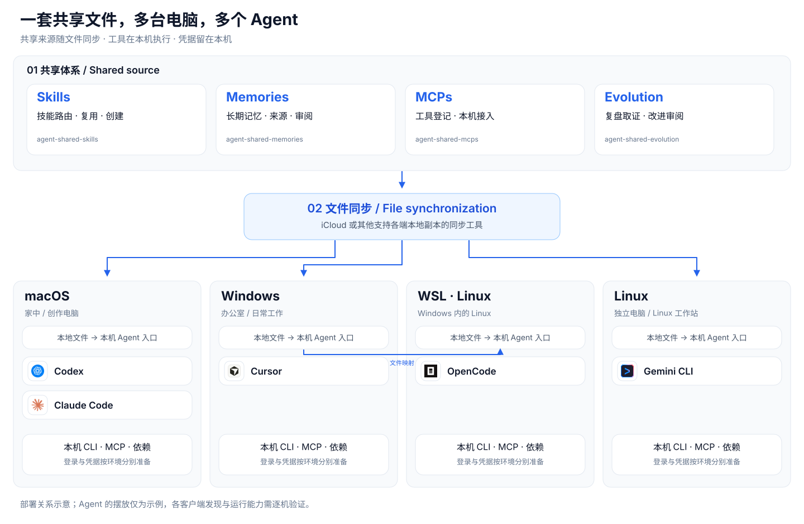

技能、记忆与规则跨设备共享。工具在各机运行，凭据留在本地。

## A 多系统如何连接 {meta="文件同步 · 本机执行"}



这是部署关系示意，不代表所有客户端均已完成实机验证。Agent 的摆放是示例，同一客户端也可以部署在不同电脑上。

## B 四个治理入口，各司其职

| 治理入口 | 负责什么 | 何时调用 |
|---|---|---|
| **agent-shared-skills** | 技能路由、创建、安装、同步和维护 | 选择技能、新增技能、检查本机依赖或接入新 Agent |
| **agent-shared-memories** | 长期记忆查询、来源追踪、修订与正式入库 | 恢复已有背景，或维护经过确认的长期结论 |
| **agent-shared-mcps** | MCP 注册表、安装方法与本机接入 | 配置当前 Agent 的 MCP，验证服务和工具调用 |
| **agent-shared-evolution** | 复盘证据、改进提案与审阅跟踪 | 跨组件复盘，或评估已实施改进的效果 |

项目专属技能可按需调用共享技能。正式修改仍遵循已有授权和审阅边界。

## C 新技能如何在另一台电脑使用

```flow LR
任务或专属技能 -> *共享技能治理: 路由与查重
共享技能治理 -> 技能说明: 复用或创建
技能说明 -> 审阅后写入: 用法与依赖齐全
审阅后写入 -> 文件同步
文件同步 -> 本机接入: 补齐发现入口
本机接入 -> 准备依赖: CLI 或 MCP
准备依赖 -> *实际验证
```

技能说明需包含用途、触发条件、步骤、依赖和成功判据。
另一台电脑先读说明，再检查自己的环境，不沿用其他电脑的安装状态。

## D 技能说明与本机工具怎样配合

| 技能类型 | 同步到各设备 | 各机分别准备 | 成功判据 |
|---|---|---|---|
| 纯方法 Skill | 步骤、判断规则、模板 | 所需 Agent 原生能力 | 完成一个最小任务 |
| Skill ＋ CLI | 技能说明、安装指引、必要脚本 | 对应运行时和 CLI 程序 | 版本检查与真实命令通过 |
| Skill ＋ MCP | 技能说明、MCP 模板和安装指引 | 服务程序、Agent 配置与认证 | 当前 Agent 能实际调用工具 |

文件已同步、Agent 已发现、依赖已就绪、实际调用通过，是四个不同阶段。
活跃数据库、程序安装目录和凭据不随共享目录同步。

## E 第一次下载后怎样接入

```flow LR
下载并解压 -> 选定同步目录
选定同步目录 -> Agent读取部署说明
Agent读取部署说明 -> 检查本机环境
检查本机环境 -> 预览接入方案
预览接入方案 -> 确认后创建入口
确认后创建入口 -> *查询示例记忆
```

iCloud 是一个选择，也可以使用其他本地文件同步工具。单机使用可以跳过同步工具。
新设备复用已有记忆，不用公共示例覆盖个人内容。同名私有技能默认保留。

## F 适合谁，与服务化记忆有何不同

适合办公室与家中接续工作的个人、多电脑多 Agent 使用者，以及能协调文件写入的小团队。已同步的内容可在各机本地读取，无需保持办公室电脑作为记忆服务器在线。

TencentDB Agent Memory 是优秀的服务化方案。它可以本地部署，多端共用需要访问共同后台。本项目选择文件同步，降低跨地点共享的基础设施要求；精细权限、集中自动处理和数据库并发则应评估服务化方案。多 Agent 提炼与审计需要实际组织执行，未经对照测试不宣称记忆质量更高。

## G 图标来源

图标仅用于识别客户端，不表示官方合作或兼容性认证。
Codex 使用 OpenAI 开发者站点图标，其余使用对应官方网站的产品图标。

[Codex / OpenAI](https://developers.openai.com/codex/) · [Claude Code](https://claude.com/product/claude-code) · [Gemini CLI](https://geminicli.com/) · [Cursor](https://cursor.com/) · [OpenCode](https://opencode.ai/)
